<div align="center">

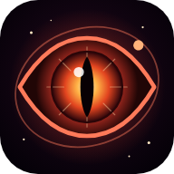

# 👁️ DemonEye — the cosmic eye that *watches you*

**A demon eye floating in a living galaxy of stars, exploding planets, supernovas and gamma waves.**
It follows your mouse, your finger or the tilt of your phone — and it has moods.

[](https://jaineil32624.github.io/DemonEye/)
[](https://github.com/jaineil32624/DemonEye/releases/latest/download/DemonEye.apk)
[](https://github.com/jaineil32624/DemonEye/releases/latest)


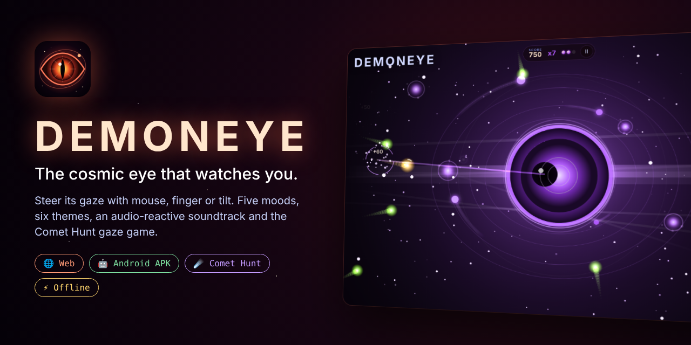

</div>

---

## ✨ What it does

| | Feature | What it does |
|---|---|---|
| 👆 | **Mouse, touch & tilt** | The pupil follows your cursor or finger — or turn on **Tilt** and steer it with your phone's gyroscope (asks for motion permission on iPhone) |
| 💥 | **Shockwaves** | Tap anywhere and a shockwave rolls out of the Eye, pushing stars and planets aside |
| 🌟 | **Charge a supernova** | Hold, watch the energy gather, release to detonate a supernova with screen shake and a bass boom |
| 😈 | **5 moods** | Watchful · Feral (slit pupil, narrowed lids) · Hypnotic (spiral iris) · Sleepy · Startled |
| 🎨 | **6 color themes** | Inferno · Abyss · Venom · Void · Solar · Prism (slow rainbow cycle) — the whole UI re-tints with it |
| 😴 | **Blinks & idle life** | Random blinks, flinches when hit, looks around when you're idle, gets drowsy… and jolts awake when you return |
| 😠 | **Don't poke it** | Tap the Eye three times quickly and it turns feral for a while |
| ☄️ | **Comet Hunt** | A gaze mini-game: hold your gaze on comets to burn them before they strike the Eye. Combos up to x8, gold comets, life orbs, a rechargeable **Eye Blast**, rising levels and a saved **best score** |
| 🎵 | **Audio-reactive** | The Space-Ranger soundtrack runs through a Web Audio `AnalyserNode` — the Eye, halos, stars and gamma ribbons throb to the bass and beats fire soft shockwaves |
| 🔇 | **No surprise autoplay** | Music starts only after your first tap, with a clear Sound / Muted button (remembered) |
| 📷 | **Snapshots** | Save the current frame as a PNG (or share it on mobile) |
| ⚙️ | **Settings** | Particle density, reduced motion, audio-reactive pulse, volume, idle animations, haptics |
| 🔗 | **Share a look** | Links like `#theme=abyss&mood=hypnotic` open the Eye in that exact style |
| ⌨️ | **Keyboard** | `M` mute · `1`–`5` moods · `T` theme · `G` game · `Space` shockwave · `B` blink · arrows steer · `S` snapshot · `F` fullscreen · `H` hide UI · `,` settings · `?` help |
| 🔋 | **Battery-friendly** | Pixel ratio capped at 2, rendering and music pause when the tab is hidden, frame-rate-independent animation |

## 📸 Screenshots

<table>
<tr>
<td>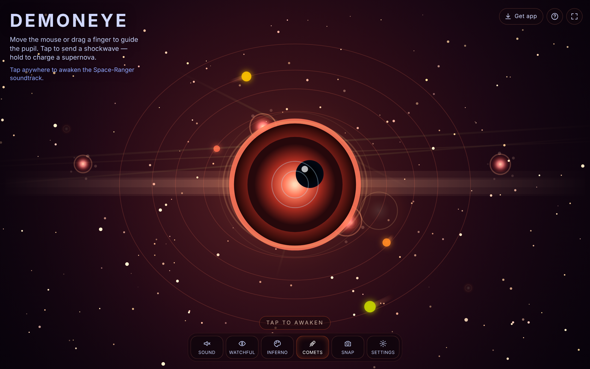<p align="center">👁️ <b>Inferno</b> — the original look</p></td>
<td>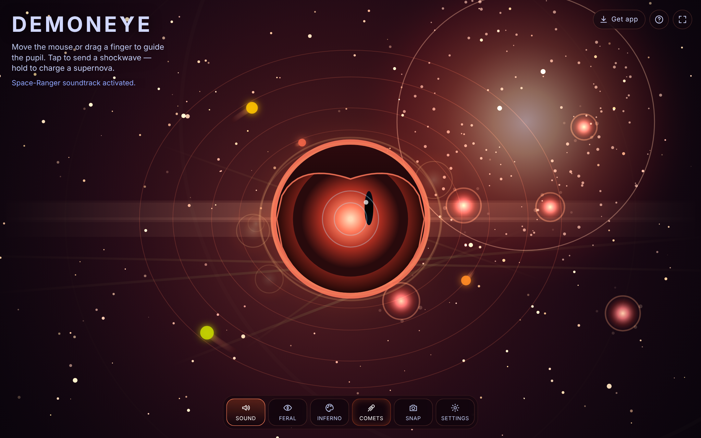<p align="center">🌟 <b>Feral</b> mood + a charged supernova</p></td>
</tr>
<tr>
<td>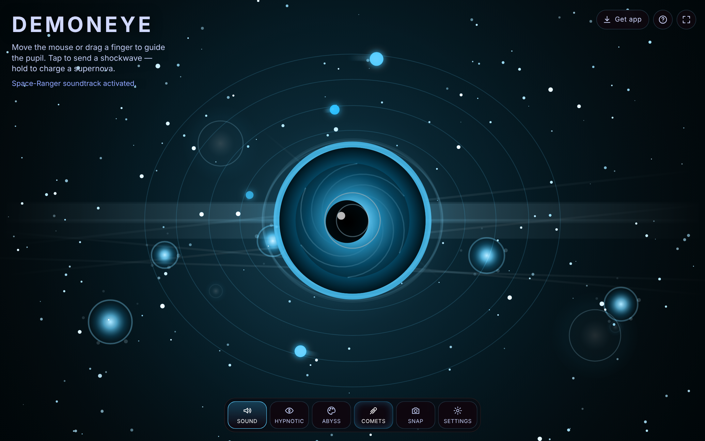<p align="center">🌀 <b>Abyss</b> theme, <b>Hypnotic</b> spiral iris</p></td>
<td>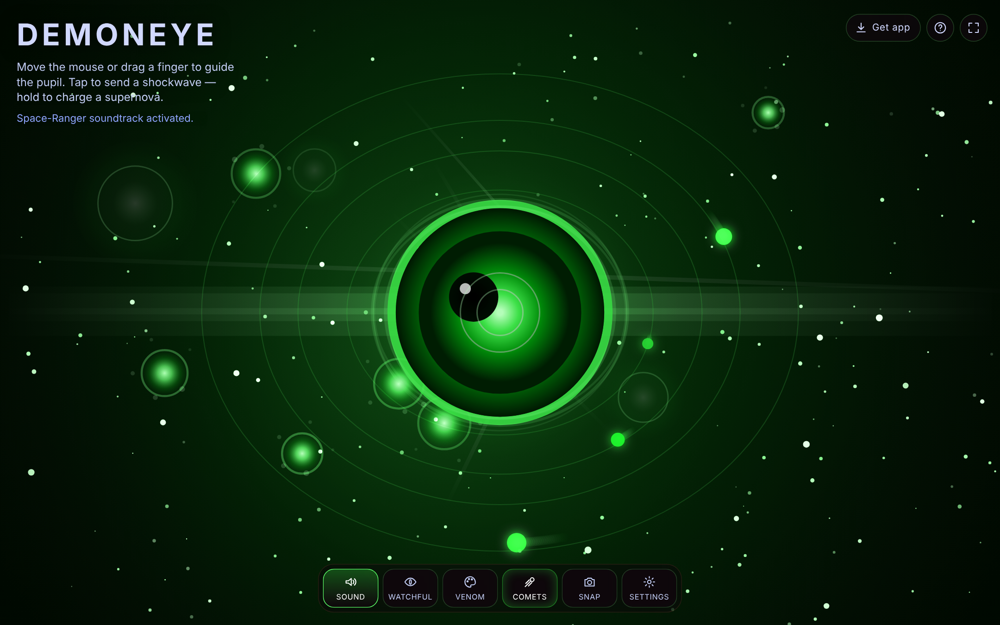<p align="center">🟢 <b>Venom</b> theme</p></td>
</tr>
<tr>
<td>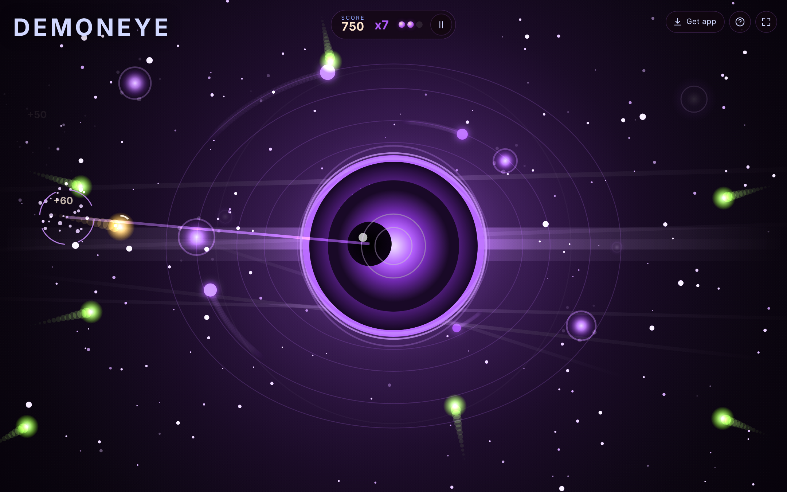<p align="center">☄️ <b>Comet Hunt</b> — burn comets with your gaze</p></td>
<td>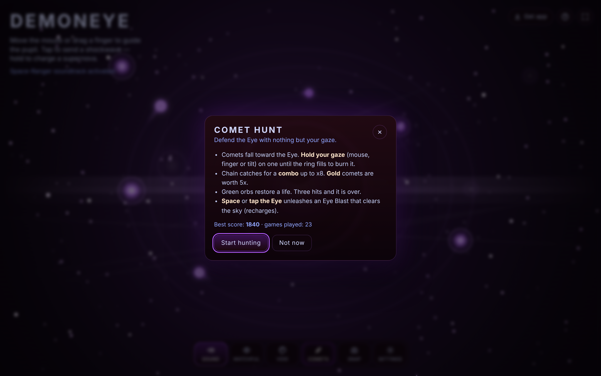<p align="center">🏆 Rules, best score & games played</p></td>
</tr>
<tr>
<td>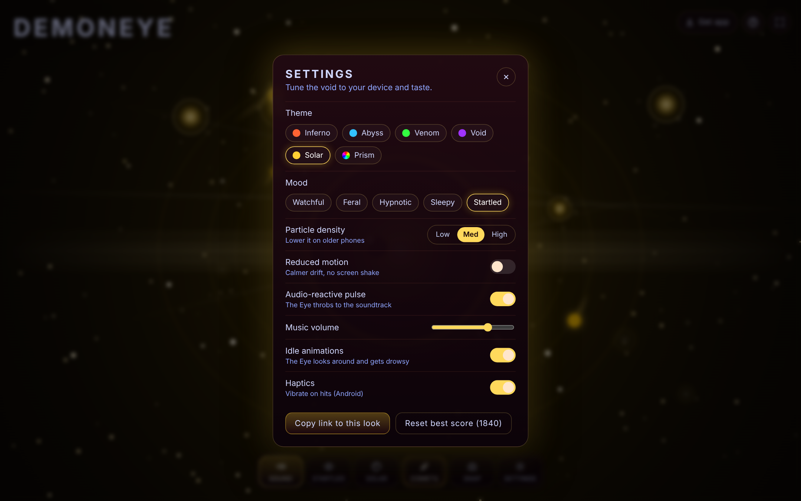<p align="center">⚙️ <b>Settings</b> — themes, moods, density, motion</p></td>
<td>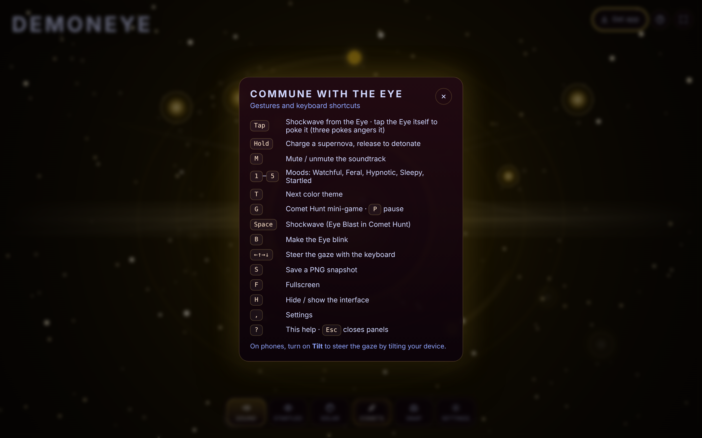<p align="center">⌨️ Gestures & keyboard shortcuts</p></td>
</tr>
</table>

<p align="center">
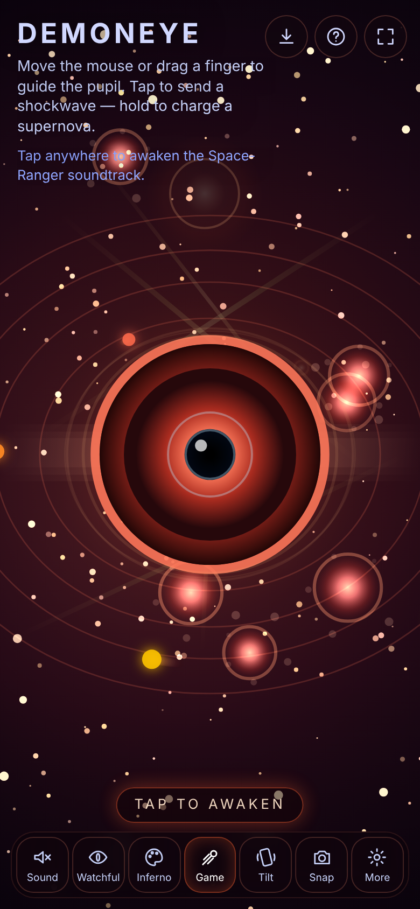
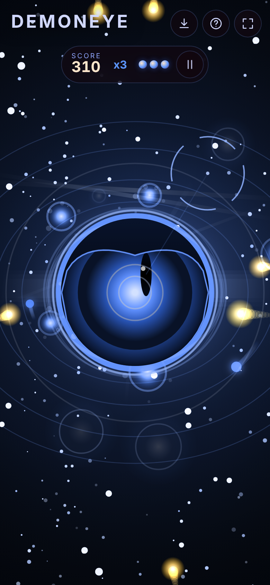
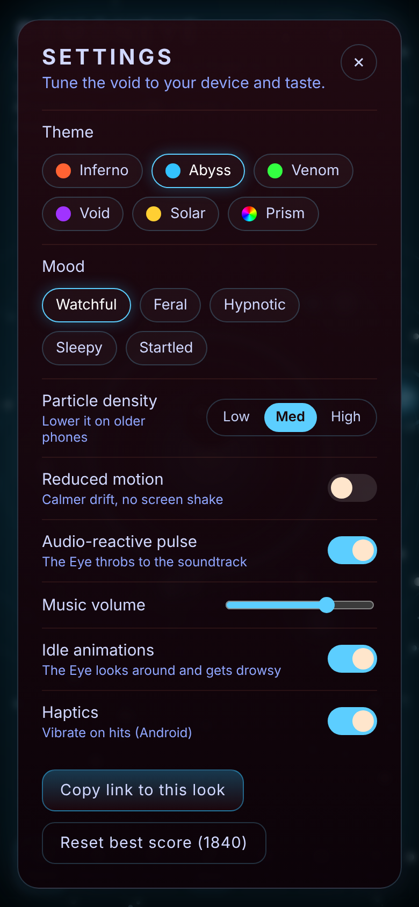
<br><em>📱 Touch-first on phones — tap, hold, drag and tilt</em>
</p>

## 📥 Get DemonEye

| Platform | How |
|---|---|
| 🌐 **Web** | Open **[jaineil32624.github.io/DemonEye](https://jaineil32624.github.io/DemonEye/)** — nothing to install |
| 🤖 **Android** | Download **[DemonEye.apk](https://github.com/jaineil32624/DemonEye/releases/latest/download/DemonEye.apk)** → open it → allow *Install unknown apps* if asked |
| 💻 **Windows / Mac / Chromebook** | Open the website in Chrome or Edge → click **⬇ Get app** → **Install** |
| 🍎 **iPhone / iPad** | Open the website in Safari → **Share** → **Add to Home Screen** |
| 📦 **Offline zip** | Grab **DemonEye-web.zip** from [Releases](https://github.com/jaineil32624/DemonEye/releases/latest), unzip, open `index.html` |

> 💡 Once installed, DemonEye works **offline** — no account, no ads, no tracking. Your theme, mood, settings and best score are saved only on your device.

<p align="center">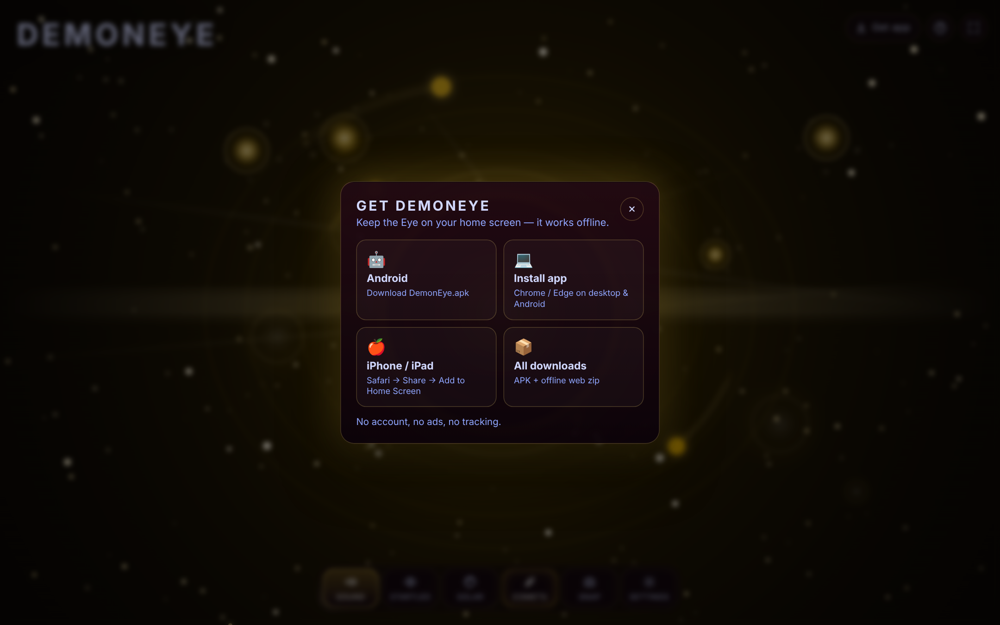</p>

## 🛠️ Run it locally

```bash
git clone https://github.com/jaineil32624/DemonEye.git
cd DemonEye
python3 -m http.server 8000      # then open http://localhost:8000
```

No build step and no dependencies — plain HTML, CSS and JavaScript on a 2D canvas.

## 🗂️ Project structure

```
DemonEye/
├── index.html                 🧱 page shell, controls, PWA + social meta
├── style.css                  🎨 HUD, dock, panels (accent follows the theme)
├── script.js                  🧠 renderer, moods, blink/idle, audio analyser, Comet Hunt, settings
├── space-ranger-moire-…mp3    🎵 the soundtrack (streamed, not precached)
├── sw.js                      📴 offline service worker
├── manifest.webmanifest       📲 installable-app manifest
├── icons/                     🖼️ app icons (SVG + PNG + maskable)
├── docs/screenshots/          📸 images used in this README
└── .github/workflows/
    └── release.yml            🤖 builds the Android APK + publishes a Release
```

## 🚀 Releasing a new version

Bump the number in `VERSION` and push — GitHub Actions builds the APK and publishes the release automatically:

```bash
# edit VERSION to 1.1.0, then
git commit -am "Release 1.1.0" && git push
```

---

<div align="center">

Made with 🔥, ✨ and an unblinking stare by **[Jaineil Rana](https://github.com/jaineil32624)**

⭐ *If the Eye impressed you, give it a star — it's watching.* ⭐

</div>
